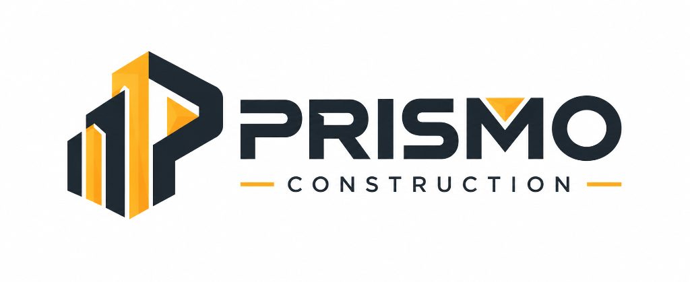

# 🏗️ Prismo Constructions — Marketing Web Portal

<div align="center">



### **Building Your Vision With Excellence**

*A modern, high-performance web platform for architectural and construction excellence.*

[](https://react.dev/)
[](https://vitejs.dev/)
[](https://tailwindcss.com/)
[](https://www.framer.com/motion/)
[](#)

[Explore Features](#-key-features) • [Tech Stack](#-tech-stack) • [Getting Started](#-getting-started) • [Project Structure](#-project-structure) • [Roadmap](#-roadmap)

---

</div>

## 📌 Overview

**Prismo Constructions** marketing frontend is an interactive, responsive, and aesthetically refined web application built to showcase construction capabilities, client portfolios, design-build services, and streamline customer inquiries. 

Engineered with **React 19**, **Tailwind CSS v4**, and **Framer Motion**, the application pairs high-converting visual storytelling with performance-first web practices.

---

## ✨ Key Features

- 🌟 **Dynamic Hero Experience:** Fluid hero carousel showcasing landmark architectural projects with glassmorphic depth and gradient typography.
- 📐 **Interactive Service Showcase:** Detailed breakdowns for Residential, Commercial, and Structural Renovation services with smooth animated cards.
- 🏢 **Portfolio Showcase:** High-resolution project catalog highlighting scale, timelines, and architectural specifics.
- 📋 **Integrated Project Cost & Discovery Estimator:** User-friendly enquiry form capturing project requirements, budget tiers (LKR), and delivery timelines.
- ⚡ **Ultra-Fast Performance:** Powered by Vite 8 with next-gen HMR, sub-second loads, and zero-bloat asset bundling.
- 📱 **Fully Responsive & Accessible:** Thoughtfully tailored for mobile, tablet, and ultra-wide desktop viewports with fluid layout systems.

---

## 🛠️ Tech Stack

| Category | Technology | Purpose |
| :--- | :--- | :--- |
| **Framework** | [React 19](https://react.dev/) | Component architecture & state management |
| **Build Tool** | [Vite 8](https://vitejs.dev/) | Next-generation bundler and dev server |
| **Styling** | [Tailwind CSS v4](https://tailwindcss.com/) | Modern utility-first CSS engine with `@tailwindcss/vite` |
| **Routing** | [React Router v7](https://reactrouter.com/) | Client-side routing across multi-page views |
| **Animations** | [Framer Motion](https://www.framer.com/motion/) | Smooth UI motion and interaction physics |
| **Icons** | [Lucide React](https://lucide.dev/) | Clean, lightweight modern SVG icons |
| **Linter** | [oxlint](https://oxc.rs/) | High-performance JavaScript/React linter |

---

## 🚀 Getting Started

Follow these steps to set up the project locally on your machine.

### Prerequisites

- **Node.js**: `v18.x` or higher recommended
- **npm** or **yarn** / **pnpm** / **bun**
- **Git**

### Installation

1. **Clone the repository:**
   ```bash
   git clone https://github.com/dulanjanarmd/Prismo-Constructions-marketing-frontend.git
   cd Prismo-Constructions-marketing-frontend
   ```

2. **Install project dependencies:**
   ```bash
   npm install
   ```

3. **Start the local development server:**
   ```bash
   npm run dev
   ```
   Open [http://localhost:5173](http://localhost:5173) in your browser to view the application.

---

## 💻 Available Scripts

In the project root, you can run:

| Command | Action |
| :--- | :--- |
| `npm run dev` | Starts the local dev server with hot reload |
| `npm run build` | Compiles and optimizes assets into `dist/` for production |
| `npm run preview` | Runs a local web server serving the production build |
| `npm run lint` | Runs `oxlint` to catch bugs, syntax, and performance issues |

---

## 📂 Project Structure

```text
marketing-frontend/
├── public/                     # Static media and brand assets
│   ├── fonts/                  # Custom typography (Ethnocentric)
│   ├── images/                 # High-resolution service photography
│   ├── carousel-*.jpg          # Hero image slideshow assets
│   └── prismo-logo.png         # Brand insignia
├── src/
│   ├── assets/                 # Local images and graphic assets
│   ├── components/             # Reusable UI components
│   │   ├── ImageCarousel.jsx   # Hero slide gallery component
│   │   └── PublicNavbar.jsx    # Responsive glassmorphic navigation bar
│   ├── pages/                  # Page-level route views
│   │   ├── LandingPage.jsx     # Master landing page & enquiry form
│   │   ├── AboutPage.jsx       # Corporate history, safety & values
│   │   ├── ServicesPage.jsx    # Detailed construction disciplines
│   │   └── PortfolioPage.jsx   # Completed & ongoing project catalog
│   ├── App.jsx                 # Route declarations & top-level layout
│   ├── App.css                 # Application-wide supplementary rules
│   ├── index.css               # Tailwind CSS theme configurations
│   └── main.jsx                # React application entry point
├── package.json
└── vite.config.js
```

---

## 🗺️ Roadmap

- [x] Initial React 19 + Tailwind v4 + Vite architecture
- [x] Responsive Hero Section with auto-playing media carousel
- [x] Multi-tier Quote & Consultation form
- [ ] Direct inquiry integration with Backend API / Email notification service
- [ ] Customer testimonials and real-time project progress tracker
- [ ] Dark / Light mode theme switcher

---

## 🤝 Contributing

Contributions are welcomed! If you have suggestions or improvements:

1. Fork the Project
2. Create your Feature Branch (`git checkout -b feature/AmazingFeature`)
3. Commit your Changes (`git commit -m 'feat: Add AmazingFeature'`)
4. Push to the Branch (`git push origin feature/AmazingFeature`)
5. Open a Pull Request

---

## 📄 License

This project is proprietary and confidential. All rights reserved by **Prismo Constructions**.

<div align="center">
<sub>Crafted with passion for engineering and architecture by the Prismo Engineering Team.</sub>
</div>
